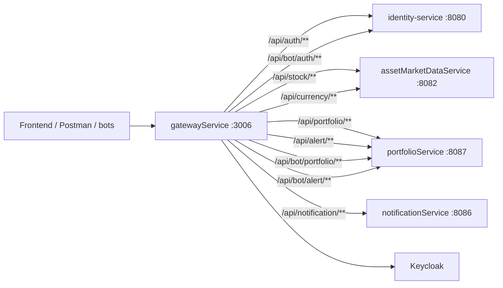

# gatewayService

**Ponto de entrada HTTP do ChainTracker.** O gateway recebe as requisições do frontend e dos bots, valida a autenticação e encaminha cada chamada para o microsserviço responsável, repassando o token do usuário quando necessário.

---

## Visão geral

O `gatewayService` é a única porta de entrada pública do ecossistema. Ele:

- publica as rotas `/api/**` do ChainTracker;
- valida JWTs emitidos pelo Keycloak;
- oferece login OAuth2 para navegadores (authorization code);
- aceita Bearer token diretamente, o que permite testar as APIs por Postman, curl ou qualquer cliente HTTP;
- repassa o token ao serviço de destino com o filtro `TokenRelay`;
- concentra a configuração de CORS, sessão e segurança de borda.

O gateway não possui banco de dados nem regras de negócio próprias. Ele é stateless do ponto de vista de domínio.

---

## Stack

| Item | Tecnologia |
|---|---|
| Linguagem / runtime | Java 21 |
| Framework | Spring Boot 4.1.1 |
| Spring Cloud | 2025.1.3 |
| Gateway | `spring-cloud-starter-gateway-server-webflux` |
| HTTP | Spring WebFlux (reativo) |
| Segurança | Spring Security + OAuth2 Client + OAuth2 Resource Server |
| Documentação | Springdoc OpenAPI + Swagger UI |
| Build | Maven (wrapper `mvnw`) |

---

## Posição no ecossistema



---

## Como funciona

### 1. Roteamento

As rotas são declaradas em `src/main/resources/application.yaml`, em `spring.cloud.gateway.server.webflux.routes`.

| ID | Caminho | Destino | Filtro |
|---|---|---|---|
| `identityService` | `/api/auth/**` | `http://identity-service:8080` | — |
| `assetMarketDataServiceStocks` | `/api/stock/**` | `http://assetmarketdata-service:8082` | `TokenRelay` |
| `assetMarketDataServiceCrypto` | `/api/currency/**` | `http://assetmarketdata-service:8082` | `TokenRelay` |
| `portfolioService` | `/api/portfolio/**` | `http://portfolio-service:8087` | `TokenRelay` |
| `portfolioServiceAlerts` | `/api/alert/**` | `http://portfolio-service:8087` | `TokenRelay` |
| `notificationService` | `/api/notification/**` | `http://notification-service:8086` | `TokenRelay` |
| `identityServiceBot` | `/api/bot/auth/**` | `http://identity-service:8080` | `TokenRelay` |
| `portfolioServiceBotAlert` | `/api/bot/alert/**` | `http://portfolio-service:8087` | `TokenRelay` |
| `portfolioServiceBotPortfolio` | `/api/bot/portfolio/**` | `http://portfolio-service:8087` | `TokenRelay` |
| `openApiAssetMarketData` | `/docs/asset/v3/api-docs` | `http://assetmarketdata-service:8082` | `SetPath=/v3/api-docs` |
| `openApiIdentity` | `/docs/identity/v3/api-docs` | `http://identity-service:8080` | `SetPath=/v3/api-docs` |
| `openApiPortfolio` | `/docs/portfolio/v3/api-docs` | `http://portfolio-service:8087` | `SetPath=/v3/api-docs` |

Observações:

- `/api/auth/**` é encaminhado sem `TokenRelay`; registro e login são públicos no `identity-service`.
- As demais rotas recebem o filtro `TokenRelay`, que copia o token autenticado no gateway para o header `Authorization` da requisição encaminhada.
- A rota `/api/notification/**` está reservada para o `notificationService`. Atualmente esse serviço atua como consumidor Kafka e cliente dos bots, sem controllers HTTP de negócio.

### 2. Autenticação e autorização

O `SecurityConfig` define:

- `/api/auth/**` → permitido sem autenticação;
- qualquer outra rota → exige autenticação;
- `oauth2Login()` → habilita o fluxo de login por navegador (authorization code);
- `oauth2ResourceServer().jwt()` → habilita a validação de Bearer token em chamadas diretas.

O gateway valida o JWT com o `issuer-uri` do Keycloak:

```yaml
spring:
  security:
    oauth2:
      resourceserver:
        jwt:
          issuer-uri: http://keycloak:8080/realms/ChainTracker
```

### 3. Fluxo de autenticação

#### Login pelo navegador

1. O usuário acessa uma rota protegida.
2. O gateway redireciona para o Keycloak (`gateway-client`, authorization code).
3. Após o login, o Keycloak devolve o código e o gateway troca por um token.
4. O token fica associado à sessão web.
5. O `TokenRelay` injeta o token nas chamadas aos serviços internos.

#### Chamada com Bearer token

1. O cliente envia `Authorization: Bearer <jwt>`.
2. O gateway valida assinatura, emissor e expiração.
3. O `TokenRelay` repassa o mesmo token ao serviço de destino.

#### Chamadas dos bots

O `notificationService` obtém um token de **client credentials** no Keycloak usando o client `notification-client` com escopo `bot` e chama o gateway. As rotas `/api/bot/**` são encaminhadas com `TokenRelay`; os serviços de destino exigem a authority `SCOPE_bot`.

### 4. Porta e configuração de runtime

- `server.port: 8079` no `application.yaml`;
- no `docker-compose.yaml`, o gateway sobe com `SERVER_PORT=3006` e é exposto em `3006:3006`;
- no stack completo, a URL de entrada é `http://localhost:3006`.

### 5. Cliente OAuth2

Configuração presente no `application.yaml`:

```yaml
spring:
  security:
    oauth2:
      client:
        registration:
          keycloak:
            client-id: gateway-client
            authorization-grant-type: authorization_code
            scope: openid, profile, offline_access
        provider:
          keycloak:
            issuer-uri: http://keycloak:8080/realms/ChainTracker
```

### 6. Documentação OpenAPI

O gateway publica um Swagger UI agregador em `http://localhost:3006/swagger-ui.html`. O seletor no topo da página alterna entre as especificações de:

- `assetMarketDataService`
- `identity-service`
- `portfolioService`

As especificações são obtidas pelo próprio gateway nos caminhos `/docs/asset/v3/api-docs`, `/docs/identity/v3/api-docs` e `/docs/portfolio/v3/api-docs`, que são reescritos para `/v3/api-docs` no serviço de destino. O `notificationService` não aparece porque é orientado a eventos e não expõe controllers HTTP de negócio.

Os endpoints de documentação são públicos; as chamadas de negócio continuam exigindo autenticação. Use o botão **Authorize** dentro de cada especificação com um Bearer token do Keycloak.

---

## Exemplos de uso

### Login

```bash
curl -X POST http://localhost:3006/api/auth/login \
  -H "Content-Type: application/json" \
  -d '{"username":"usuario","password":"senha"}'
```

A resposta é o `AccessTokenResponse` emitido pelo Keycloak, contendo `access_token`, `expires_in`, `refresh_token` e `token_type`.

### Consulta autenticada

```bash
curl http://localhost:3006/api/portfolio \
  -H "Authorization: Bearer <access_token>"
```

### Criação de posição

```bash
curl -X POST http://localhost:3006/api/portfolio/<portfolioId>/positions/cripto/market \
  -H "Authorization: Bearer <access_token>" \
  -H "Content-Type: application/json" \
  -d '{"assetId":"bitcoin","quantity":0.5}'
```

---

## Configuração

| Propriedade | Valor | Observação |
|---|---|---|
| `server.port` | `8079` | sobrescrito por `SERVER_PORT` no compose |
| `spring.application.name` | `gatewayService` | nome lógico |
| `spring.cloud.gateway.server.webflux.routes` | tabela de rotas | ver seção de roteamento |
| `spring.security.oauth2.client.registration.keycloak.client-id` | `gateway-client` | client do Keycloak |
| `spring.security.oauth2.client.registration.keycloak.authorization-grant-type` | `authorization_code` | login pelo navegador |
| `spring.security.oauth2.client.registration.keycloak.scope` | `openid, profile, offline_access` | escopos solicitados |
| `spring.security.oauth2.client.provider.keycloak.issuer-uri` | `http://keycloak:8080/realms/ChainTracker` | provider |
| `spring.security.oauth2.resourceserver.jwt.issuer-uri` | `http://keycloak:8080/realms/ChainTracker` | validação de Bearer token |
| `springdoc.swagger-ui.urls` | três especificações | asset, identity e portfolio |
| `springdoc.swagger-ui.disable-swagger-default-url` | `true` | remove a especificação vazia padrão |

O gateway depende de o realm `ChainTracker` e o client `gateway-client` existirem no Keycloak. No stack completo, o container aguarda o Keycloak ficar saudável antes de subir.

---

## Como executar

### Localmente

Pré-requisitos: Java 21 e um Keycloak acessível com o realm `ChainTracker`.

```bash
./mvnw spring-boot:run
```

O gateway sobe em `http://localhost:8079`.

### Com Docker

```bash
./mvnw clean package -DskipTests

docker build -t gateway-service .
docker run --rm -p 3006:3006 -e SERVER_PORT=3006 gateway-service
```

### No stack completo

No repositório `ChainTracker`, o gateway é construído a partir de `./gatewayService`, exposto em `3006:3006` e configurado com `SERVER_PORT=3006`.

---

## Estrutura do projeto

```text
gatewayService/
├── src/main/java/gatewayService/
│   ├── config/
│   │   └── SecurityConfig.java   # regras de segurança e OAuth2
│   └── GatewayServiceApplication.java
├── src/main/resources/
│   └── application.yaml          # rotas e configuração do OAuth2
├── src/test/java/gatewayService/
│   └── GatewayServiceApplicationTests.java
├── Dockerfile
├── pom.xml
└── mvnw / mvnw.cmd
```

---

## Observações de operação

- Rotas novas devem ser adicionadas em `spring.cloud.gateway.server.webflux.routes`.
- Rotas que precisam do token do usuário no serviço de destino devem declarar o filtro `TokenRelay`.
- O gateway não define timeout, retry ou circuit breaker por rota na configuração atual; o comportamento é o padrão do Spring Cloud Gateway.
- Como o gateway é reativo, a aplicação roda sobre Netty e não sobre Tomcat.
